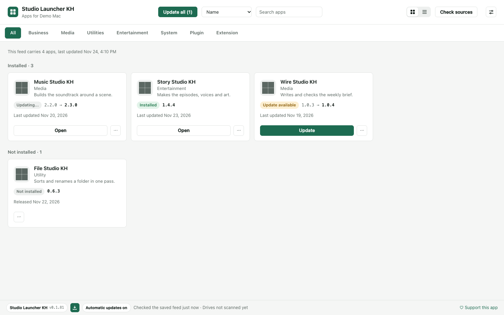
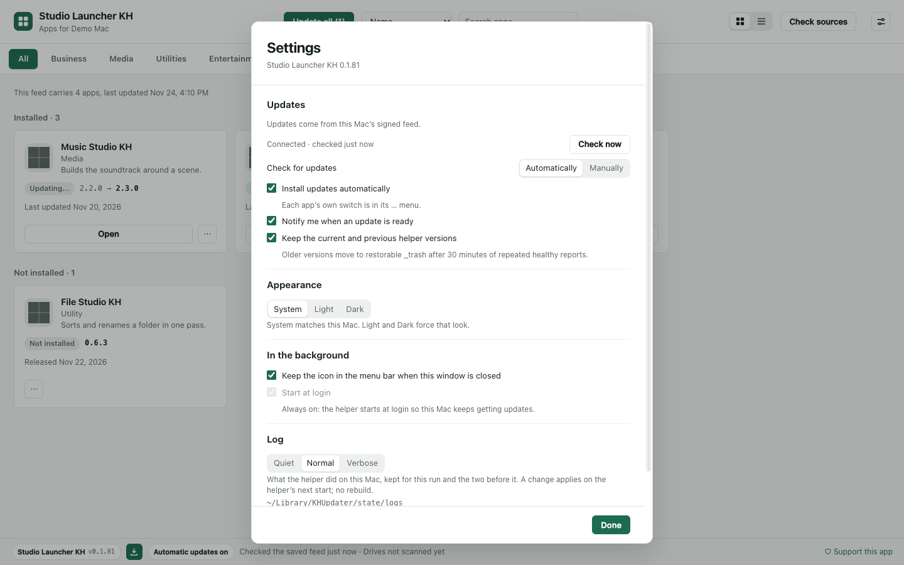

# Studio Launcher KH and its updater

The update system for the studio's apps. Studio Launcher KH is the window; its updater installs and
updates every app on a Mac from the signed feed. It never runs or routes production work, never
pauses or resumes jobs, and never changes app settings. Updates install automatically on a fresh Mac,
with one visible switch on the main screen.

## What it looks like





Dark: [app list](docs/screenshots/app-list-dark.png) · [Settings](docs/screenshots/settings-dark.png).

Both are the released build with demo data in a throwaway folder, not anyone’s Mac.

## Roles

- **Publisher** (dev Mac): `khu keygen`, `khu publish`, `khu enrol`, `khu serve`
- **Agent** (each Mac): `khu agent --config <file>`
- **Stub**: `khu-stub --base <dir>` (kept alive by launchd)

## Release path (owner, 2026-11-12)

This Mac builds, signs and tests. The release host, 1301, is the **only** feed writer, and every
Mac pulls from it. A publish run on this Mac reaches nobody.

1. Build and sign here: `packaging/build-launcher.sh <version> <publisher.json>`.
   It writes its DMG into `dist/` — no separate copy step.
2. Once the release is accepted, `packaging/record-dist.sh rotate <app> <version>` keeps the
   latest two installers and retires the rest to `_trash`.
3. `packaging/release-push.sh <feed-app-id> <version> <dmg> <changelog>` copies the DMG and its
   changelog to the host's staging folder, publishes there with the host's own key, and reads the
   served feed back to prove the version it now offers. With `KHU_PUBLIC_REPO=<owner/name>` set
   (the app's own repo, per RELEASE-POLICY §2b) it first uploads the artifact to that repo's
   `<app>-<version>` release with `packaging/github-asset.sh`, proves GitHub stored those exact
   bytes, fetches the asset back anonymously and hashes it — the download a client would make — and
   gives the publish that address; the served row is read back to prove the address survived.
4. Macs pull from `https://theng12.github.io/kh-releases/release.json` — GitHub Pages is the only feed.

Page sync is retired (owner ruling 2026-11-22: one signed feed, GitHub-only downloads). It synced
a second copy of each release onto the public page; the feed is now served from Pages itself, so
nothing rebuilds or compares a mirror beside it.

Test installs on this Mac are expected and harmless: they prove download and update, they are not
the release source.

## Build

```
./build.sh build
./build.sh test
```

(Requires the Swift 6.4 command-line tools; XCTest is not used — tests use the
`Testing` framework.)

## The app

`packaging/build-launcher.sh <version> <publisher.json>` builds `build/Studio Launcher KH.app` and
its DMG: the menu-bar helper as an app, with this Mac's apps in a window and, behind **Fleet…**, a
window onto the publisher's page (http://127.0.0.1:8790/). That fleet view used to be the separate
Update Studio KH.app; it is retired into this one (owner, 2026-11-17). The headless `khu` agent and
`khu-stub` supervisor ship inside it and stay separate: a Mac with no menu bar still updates.

## Subcommands

See `docs/DESIGN.md`.
